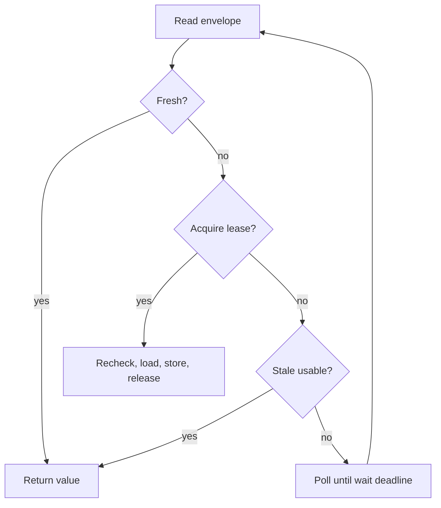

# cache-shield

Small, framework-independent PHP 8.3+ cache stampede protection. Uses PSR-16 storage and an explicit atomic lock provider. No server, scheduler, or framework lifecycle hooks.

## Why

When a popular cache key expires, simultaneous requests can all run the same expensive query. CacheShield lets one caller refresh while other callers use a still-valid stale value. On a cold miss, contenders poll for a bounded period rather than run unprotected duplicate work.



## Install and quickstart

The package is prepared for publication; it is not yet registered on Packagist. From the repository run `composer install`. After publication the intended install command is `composer require cache-shield/cache-shield`.

```php
use CacheShield\CacheShield;
use CacheShield\Lock\RedisLockProvider;

// $cache implements Psr\SimpleCache\CacheInterface; $redis is connected ext-redis.
$shield = new CacheShield(
    $cache,
    new RedisLockProvider($redis),
    freshTtl: 60,
    staleTtl: 300,
    lockTtlMilliseconds: 30_000,
    waitMilliseconds: 1_000,
);
$value = $shield->remember('report:v1', fn () => expensiveQuery());
```

Fresh TTL starts after successful computation. Stale TTL is an **additional** window: 60 + 300 seconds total retention in this example. Fresh TTL must be positive; stale TTL may be zero. Values include null and false. Cache values must be serializable by your adapter. Keys are SHA-256 hashed with the configured namespace into PSR-16-safe keys. Use a dedicated cache namespace; avoid collisions with other users of that storage. All callers sharing a logical key must use the same namespace, storage, lock provider/prefix and compatible TTLs and value schema.

The winner refreshes synchronously; its request pays the computation latency. Other callers serve stale immediately when the lock is occupied. This library does not schedule background work. A single request after the fresh window will refresh itself even if stale data exists.

## Outcomes

| Condition | Behavior |
| --- | --- |
| Fresh entry | Return without locking or running loader |
| Stale entry, lock free | Recheck under lease, refresh synchronously |
| Stale entry, lock busy | Return stale while within its deadline |
| Missing, malformed, or hard-expired entry | Try lease; otherwise poll up to wait deadline |
| Cold contention times out | Throw `LockTimeoutException`; no unlocked loader |
| Loader throws | Release lease, propagate original Throwable; preserve old entry |
| Storage `set()` returns false | Throw `CacheWriteException`, release lease |
| Storage/lock backend throws | Propagate, fail closed |
| Release throws | Propagate unless a primary exception is already in flight |

No automatic stale-on-error fallback: the refreshing caller sees the error. Subsequent callers may still use stale values during contention, or retry refresh. A failing loader can be retried on each new request; add application-level circuit breaking if needed. No recursion or unlimited retry after loader failure. The polling deadline uses a monotonic clock and bounds polling, not backend I/O or loader runtime; configure connection/read timeouts on your clients. Value deadlines use wall time, requiring synchronized clocks across hosts.

## Redis locking and limitations

`RedisLockProvider` requires ext-redis and a connected client. Acquisition uses one `SET key token NX PX milliseconds`, with a random 256-bit ownership token. Release uses a Lua compare-and-delete atomically; an expired owner cannot delete a successor's lock. See [Redis SET documentation](https://redis.io/docs/latest/commands/set/) and [locking patterns](https://redis.io/docs/latest/develop/clients/patterns/distributed-locks/).

Use a dedicated Redis connection with no serializer, key prefix, compression, MULTI, or pipeline mode configured. Set finite network timeouts. Authentication, TLS, and connection lifecycle belong to the application. Each process should create its own connection.

**A lease is not fencing.** If a computation runs beyond its lock TTL, another caller can acquire the lock and run concurrently. The old owner can still publish an older result, overwriting a newer one: PSR-16 has no atomic token-checked publication primitive. There is no renewal, exactly-once guarantee, or linearizable cache write. Size the lease above expected computation plus publication latency, constrain loader duration, and use backend-specific fenced writes if stronger guarantees are required. Loaders should be idempotent reads, not non-repeatable side effects.

This adapter targets a single Redis primary. Redis failover, eviction, data loss, process suspension, partitions and expired leases can permit duplicate work. It does not implement Redlock or promise distributed correctness under those conditions. Never implement a lock with PSR-16 `get()` followed by `set()`: that is not atomic. Non-atomic custom lock providers are unsafe across processes. Process-local caches do not share refreshed values across workers even with a Redis lock. Use coherent shared storage for cross-process coordination; non-atomic/non-coherent cache backends do not provide distributed correctness. Cache and lock storage operations are not transactional.

Keep cache data until fresh + stale TTL; premature eviction removes stale availability. The library stores a versioned array envelope and validates deadlines on every read, even if a backend retains expired entries. Avoid extremely large TTLs that exceed backend limits.

## Simultaneous database requests

The example uses SQLite plus a simulated 750 ms report query and shared Redis storage:

```sh
composer install
php examples/setup.php
seq 1 8 | xargs -P8 -I{} php examples/query.php
# Repeat after 6 seconds: one refreshes; others can return stale immediately.
```

Requires Redis, ext-redis and pdo_sqlite. Configure `REDIS_HOST` / `REDIS_PORT`. Query execution is printed to stderr; returned totals go to stdout. The demo uses a disposable `examples/example.sqlite` database. Do not execute setup concurrently with requests.

## Development

```sh
composer validate --strict
composer test
REDIS_HOST=127.0.0.1 composer test:redis
composer analyse
composer style
```

Unit tests use in-memory cache and lock adapters. Redis integration uses two independent client connections to check contention, expiry and safe release; it is skipped unless `REDIS_HOST` and ext-redis are present. This is a single-node integration test, not proof of distributed correctness. CI runs PHP 8.3, 8.4 and 8.5 with Redis. See `VERIFICATION.md` for the actual local execution record.

MIT licensed.
